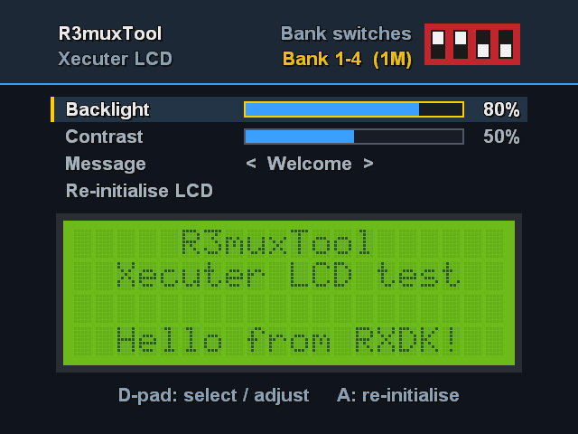

# R3muxTool

<p align="center"><b>Xecuter 3 LCD and bank switch tool for the original Xbox — set the LCD backlight and contrast, send a message, and see the bank switch positions</b></p>

<p align="center">
  <a href="https://github.com/Team-Resurgent/R3muxTool/blob/main/LICENSE.md"></a>
  <a href="https://github.com/Team-Resurgent/R3muxTool/actions/workflows/build.yml"></a>
  <a href="https://discord.gg/VcdSfajQGK"></a>
</p>

<p align="center">
  <a href="https://ko-fi.com/J3J7L5UMN"></a>
  <a href="https://www.patreon.com/teamresurgent"></a>
</p>

<p align="center">
  <a href="https://github.com/Team-Resurgent/R3muxTool/releases/latest"></a>
</p>

<p align="center">
  
</p>

A small original Xbox title for consoles with a **Team Xecuter 3** modchip (or a
chip that emulates one, such as Modxo / ModXover). It drives the HD44780 character LCD
on the X3's display header and reads the chip's bank switches. It's built with
[RXDK](https://github.com/Team-Resurgent/RXDK-Libs), the open Xbox SDK. The LCD driver
is ported from [PrometheOS](https://github.com/Team-Resurgent/PrometheOS-Firmware)
(`displayHD44780Xecuter`).

## Features

- **Backlight and contrast**: 0–100%, sent to the LCD as you change them.
- **Messages**: pick a message and it is written to the 20×4 LCD straight away.
  Built in: a welcome screen, Hello World, a live settings readout and a character test.
- **LCD preview**: an on-screen 5×8 dot-matrix copy of what is on the panel, tinted by
  the backlight and contrast settings.
- **Bank switch positions**: the X3's four bank-select DIP switches, with the bank and
  size they select (e.g. *Bank 1-4 (1M)*), updated live as you flip them. It shows
  *Software banking* when a BIOS has taken over banking, and *No X3 detected* when no
  chip answers.
- **Re-initialise LCD**: runs the HD44780 init sequence again, e.g. after hot-plugging
  the display.

## Controls

| Button | Action |
| --- | --- |
| D-pad Up / Down | Select an item |
| D-pad Left / Right | Adjust backlight / contrast, or pick a message |
| A | Re-initialise the LCD (on that item) |

## Getting started

1. Download the [latest release](https://github.com/Team-Resurgent/R3muxTool/releases/latest).
2. Copy the `R3muxTool` folder from `R3muxTool.zip` to your Xbox hard drive (for example
   `E:\Apps\R3muxTool`) and launch `default.xbe` from your dashboard. Or boot
   `R3muxTool.iso` from an ODE or in xemu.

**xemu:** builds with Xecuter emulation show the LCD under **Debug ▸ LCD**. Set
`lcd = 'xecuter'` in `[sys]`, plus `modchip = 'xecuter'` and `modchip_bank` to see the
bank switches.

## Building from source

Install RXDK through the [VS Code extension](https://github.com/Team-Resurgent/RXDK-VSCode)
(or run `scripts/stage-rxdk.ps1`, which stages the clang toolchain, SDK and host tools into
`C:\ProgramData\RXDK`), then:

```powershell
C:\ProgramData\RXDK\tools\Rxdk.Cli.exe build --project-root . --configuration Release
```

The `.xbe`, the ready-to-copy `Build\R3muxTool` folder and the `.iso` land in
`out\Release`. The project can also be opened directly in VS Code through its
`rxdk.project.json`. CI builds every push and publishes the rolling `latest` release via
[`.github/workflows/build.yml`](.github/workflows/build.yml). Push a `v*` tag for a
fixed release.

### Layout

```
R3muxTool.cpp       UI: menu, LCD preview, bank switch display
XecuterLcd.cpp/.h   X3 LCD driver (HD44780 over the 0xF503-0xF508 ports) and bank switch reads
LcdFont.h           5x8 dot-matrix glyphs for the on-screen preview
Common/             XDK sample framework (XBApp, XBFont, XBInput, ...) from RXDK-Samples
Font.rdf            Font resource, packed to Media/Font.xpr at build time
```

## Links

- **Source:** https://github.com/Team-Resurgent/R3muxTool
- **Open SDK (RXDK-Libs):** https://github.com/Team-Resurgent/RXDK-Libs
- **PrometheOS:** https://github.com/Team-Resurgent/PrometheOS-Firmware
- **Community:** [Discord](https://discord.gg/VcdSfajQGK) · [Patreon](https://www.patreon.com/teamresurgent) · [ko-fi](https://ko-fi.com/J3J7L5UMN)

---

*R3muxTool is built with RXDK, a clean, from-source Xbox SDK. It is not affiliated with or
endorsed by Microsoft or Team Xecuter. Licensed under GPLv3.*
